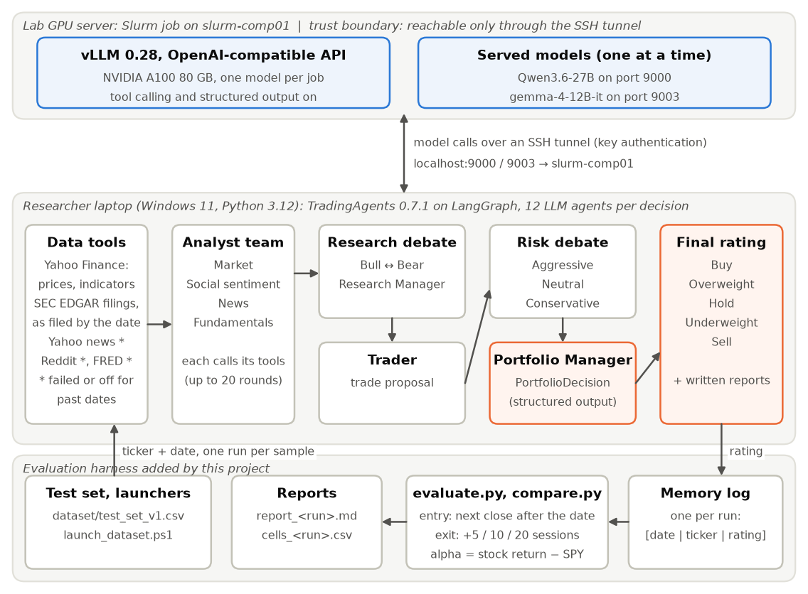

# Agent Garden: Finance Agent

A multi-agent AI system that decides whether a stock is likely to beat the market. For a given stock and date, 12 AI agents read the news, financial reports, social media and price charts, debate, and give one rating: **Buy, Overweight, Hold, Underweight or Sell**, with a plan and the reasons.

It is one of the Agent Garden workloads used to test a router that sends each request to a small or a large model. It is built on the TradingAgents framework and runs on open-weight models (Qwen3.6-27B and gemma-4-12B) served by vLLM on a lab GPU, with free data only.

Design decisions: [docs/Architecture_Decision_Records.md](docs/Architecture_Decision_Records.md)

## Status

| Working | Not done yet |
|---|---|
| End-to-end runs on two models (156 decisions) | Connection to the Agent Garden router |
| Resume after a failure; switch model by one setting | Repeated runs with a majority vote |
| Scoring with baselines and p-values; 20-sample test set | Automated tests for the scoring scripts |
| Live dashboard for demos | News and social data for past dates |

## How it works



1. A script starts one decision per stock and date.
2. Four analysts (market, social media, news, fundamentals) collect data up to that date only.
3. A bull and a bear researcher debate; a research manager writes a plan; a trader proposes a trade.
4. Three risk analysts debate the trade; the portfolio manager gives the final rating.
5. Every model call goes to one OpenAI-compatible endpoint (vLLM on the lab GPU, through an SSH tunnel).
6. A scorer checks each rating against the stock's return minus the market's (SPY) after 5, 10 and 20 trading days.

## Folder contents

| Path | Contents |
|---|---|
| `TradingAgents/` | The agent framework (base: TradingAgents v0.7.1, Apache-2.0) |
| `dataset/` | The 20-sample test set and the script that builds and checks it |
| `launch_*.ps1`, `run_*.ps1` | Run the agent on many samples (parallel, resumable) |
| `start_tunnel.ps1` | SSH tunnel to the lab's model servers |
| `start_ui.ps1`, `demo.ps1` | Live dashboard and one-command demo |
| `check_model.py` | Checks that a model server can run the agent |
| `evaluate.py`, `compare.py` | Score the ratings and compare runs |
| `results/evaluation/` | Scores of every experiment |
| `results/backtest/<run>/trading_memory.md` | The decisions of each run (rating per stock and date) |
| `docs/` | Design decisions, architecture figure and the metrics script |
| `requirements-lock.txt` | Exact versions of all Python packages |

## Prerequisites and versions

| Item | Version |
|---|---|
| Operating system | Windows 11 with PowerShell (the scripts are `.ps1`) |
| Python | 3.12.4 |
| Agent framework | TradingAgents 0.7.1 (in `TradingAgents/`) |
| Key packages | LangGraph 1.2.18, langchain-openai 1.7.3, openai 3.40.0, yfinance 1.7.0, stockstats 0.6.10, pandas 3.1.0 (all pinned in `requirements-lock.txt`) |
| Model server | vLLM 0.28.0 on the lab GPU (Slurm node `slurm-comp01`): Qwen3.6-27B on port 9000, gemma-4-12B on port 9003 |
| Access | A lab account with an SSH key (for the model server) |

## Environment variables

Copy `.env.example` to `TradingAgents/.env` and fill it in. The real `.env` is never uploaded.

| Variable | Meaning |
|---|---|
| `TRADINGAGENTS_LLM_PROVIDER` | `openai_compatible` |
| `TRADINGAGENTS_LLM_BACKEND_URL` | Model server, e.g. `http://localhost:9000/v1` |
| `TRADINGAGENTS_DEEP_THINK_LLM`, `TRADINGAGENTS_QUICK_THINK_LLM` | Model name, e.g. `Qwen3.6-27B` |
| `TRADINGAGENTS_RESULTS_DIR`, `TRADINGAGENTS_MEMORY_LOG_PATH` | Where logs and decisions are saved |
| `SEC_EDGAR_USER_AGENT` | Your name and e-mail (SEC asks for it; no key) |
| `TRADINGAGENTS_EXTRA_INDICATORS` | `true` to give the market analyst 9 extra indicators (off by default) |
| `FRED_API_KEY` | Optional macro data (off in the experiments) |
| `LAB_SSH_USER`, `LAB_SSH_HOST`, `LAB_SSH_KEY` | Lab login for `start_tunnel.ps1` |

## Install and setup

```powershell
cd TradingAgents
py -3.12 -m venv .venv
.\.venv\Scripts\pip install -r ..\requirements-lock.txt
.\.venv\Scripts\pip install -e . --no-deps
cd ..
Copy-Item .env.example TradingAgents\.env       # then fill in the values
$env:LAB_SSH_USER = "<lab user>"; $env:LAB_SSH_HOST = "<lab host>"
.\start_tunnel.ps1                               # in its own window; keep it open
curl http://localhost:9000/v1/models             # should list the model
cd TradingAgents; .\.venv\Scripts\python ..\check_model.py; cd ..   # expected: ALL OK
```

**Database:** none to migrate or seed. Each run writes its decisions to a Markdown log under `results/`, created automatically.

## Run

| What | Command (from this folder) |
|---|---|
| Test set on Qwen3.6-27B | `.\launch_dataset.ps1` |
| Test set on gemma-4-12B | `.\launch_dataset.ps1 -RunPrefix gemma_ds1 -BackendUrl http://localhost:9003/v1 -Model gemma-4-12B` |
| Test set with extra indicators | add `-ExtraIndicators` and a new `-RunPrefix` |
| First evaluation (5 stocks, 36 decisions) | `.\launch_eval.ps1` |
| Indicator comparison (arms A, B, C) | `.\launch_experiment.ps1` |

One decision takes 10–25 minutes. If a run stops, run the same command again: finished samples are skipped.

## Example input and expected output

**Demo:** `.\start_ui.ps1` opens a live dashboard (add `-BackendUrl http://localhost:9000/v1 -Model Qwen3.6-27B` for Qwen). Type the input, watch the agents work, and the decision is scored at the end. `.\demo.ps1` does the same in one command.

| | |
|---|---|
| **Input** | Ticker `NVDA`, date `2026-04-06`, all four analysts |
| **Output** | One rating with a plan and reasons |
| **Recorded result** (Qwen3.6-27B) | **Overweight**, price target $182, stop-loss $163, horizon 3–6 months |
| **Score** | NVDA then beat SPY after 5, 10 and 20 trading days: correct at all three |

Ratings can differ between runs of the same input (two identical runs agreed on 33% of ratings).

## Tests

| Check | Command | Expected |
|---|---|---|
| Framework test suite | `cd TradingAgents; .\.venv\Scripts\python -m pytest` | 1,407 passed, 6 skipped, 1 deselected (saved in `results/tests/`) |
| Model server works | `cd TradingAgents; .\.venv\Scripts\python ..\check_model.py` | `ALL OK` (chat, tool call, final decision) |
| End to end | `.\demo.ps1` | A rating is saved and scored |
| Resume after a failure | Stop a run, then run the same command again | Finished samples are skipped; the rest complete |
| Metrics | `python docs\build_report.py --metrics` | Every reported hit rate, baseline and p-value |

The scoring scripts have no automated unit tests yet; they were checked against a hand-computed example (`dataset/README.md`).

## Results

**Data:** `dataset/test_set_v1.csv` lists every sample (id, ticker, date, market condition). Settings: server-default temperature, no seed, 1 debate round, 1 risk round.

**Regenerate the scores of a run** from its decision log: `cd TradingAgents; .\.venv\Scripts\python ..\evaluate.py --name ds1 --groups ..\dataset\test_set_v1.csv "ds1_*"`

| Experiment | Decisions (`results/backtest/`) | Scores (`results/evaluation/`) |
|---|---|---|
| E1 First evaluation, Qwen3.6-27B | `eval_*`, `20261029_180800` | `report_baseline36_final.md` |
| E2 Indicator comparison, Qwen3.6-27B | `eval_*`, `expB_*`, `expC_*` | `report_A.md`, `report_B.md`, `report_C.md`, `report_compare.md` |
| E3 Test set, Qwen3.6-27B | `ds1_*` | `report_ds1.md` |
| E4 Test set, gemma-4-12B | `gemma_ds1_*` | `report_gemma_ds1.md` |
| E5 Test set, gemma-4-12B + indicators | `gemma_ind_ds1_*` | `report_gemma_ind_ds1.md` |

Hit rate on the test set after 5 / 10 / 20 trading days:

| Setup | Hit rate | "Always Buy" rule |
|---|---|---|
| Qwen3.6-27B | 44% / 50% / 39% | 65% / 60% / 70% |
| gemma-4-12B | 67% / 56% / 72% | 65% / 60% / 70% |
| gemma-4-12B + extra indicators | 68% / 63% / 68% | 65% / 60% / 70% |

## Operations

| Task | How |
|---|---|
| Start the model server | On the lab login node: `sbatch vllm_Qwen36-27b.sbatch` or `sbatch vllm_gemma4-12b.sbatch`; check with `squeue` |
| Start / stop the tunnel | `.\start_tunnel.ps1`; close its window to stop |
| Check the server | `curl http://localhost:9000/v1/models` (Qwen) or `:9003` (gemma) |
| Reset a run | Delete its folder in `results/backtest/` and run again |
| Logs | `results/backtest/<run>/backtest_console.log` |

| Problem | Fix |
|---|---|
| `Connection error` on every call | Tunnel closed or model job stopped: check `curl` and `squeue`, restart, rerun the same command |
| Another model answers on a port | The lab swapped models: point `-BackendUrl` and `-Model` at the right port |
| A rating such as "REVIEW" | Outside the five allowed values; logged but not scored |

**External services and cost:** the lab GPU (needs a lab account), Yahoo Finance (free) and SEC EDGAR (free, contact e-mail). No paid APIs.

## Limitations

- Small samples: 20–36 decisions per experiment.
- One run per sample, and repeated runs often disagree.
- Free news and social sources return nothing for past dates.
- The model servers are shared and can be stopped or swapped by the lab.
- No setup clearly beats always saying Buy yet.

## Changes to the base framework

- `tradingagents/dataflows/extra_indicators.py` (new): 9 extra indicators for the market analyst; selection based on the BichengWang/TradingAgents fork.
- `market_analyst.py`, `vendors/yahoo/market.py`, `default_config.py`, `trading_graph.py`: an on/off switch for these indicators, off by default.
- `cli/display.py`, `cli/selections.py`: a plain "Agent Garden: Finance Agent" header for demos (`start_ui.ps1`).

## Submission version

Final tag: `cs5903-final-2026`.
